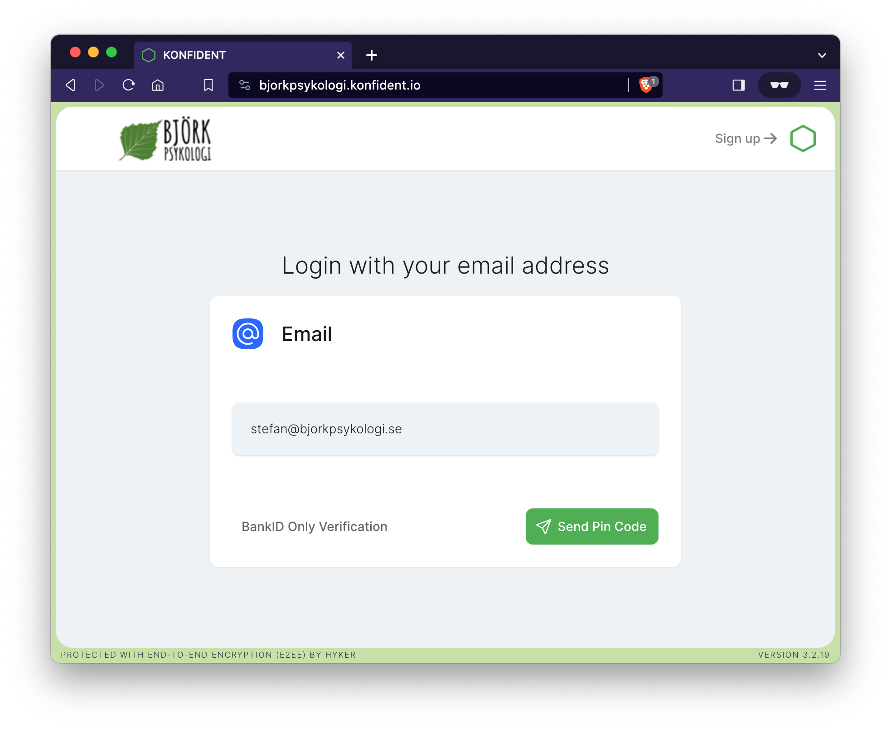
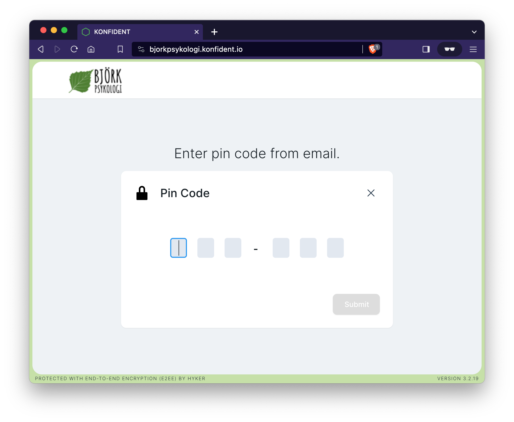
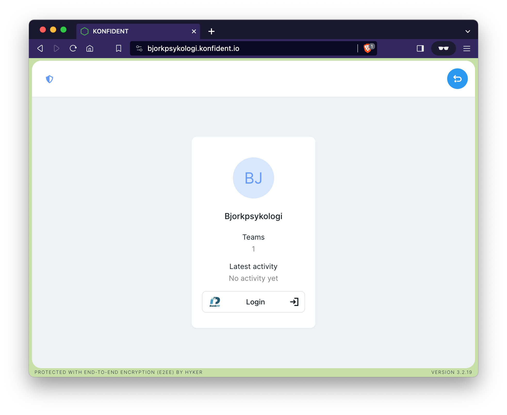
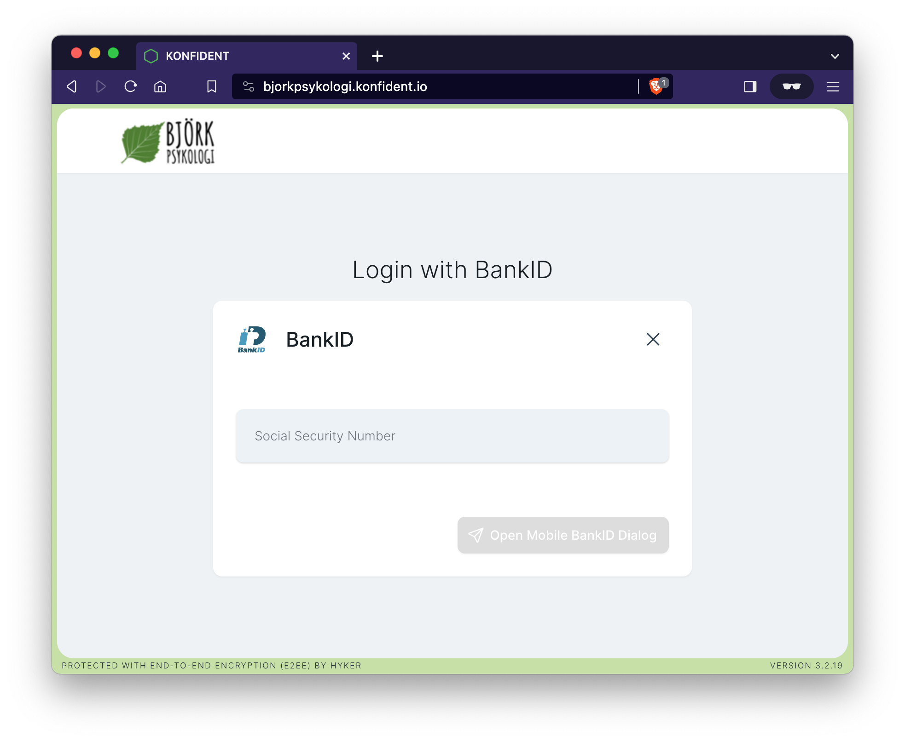
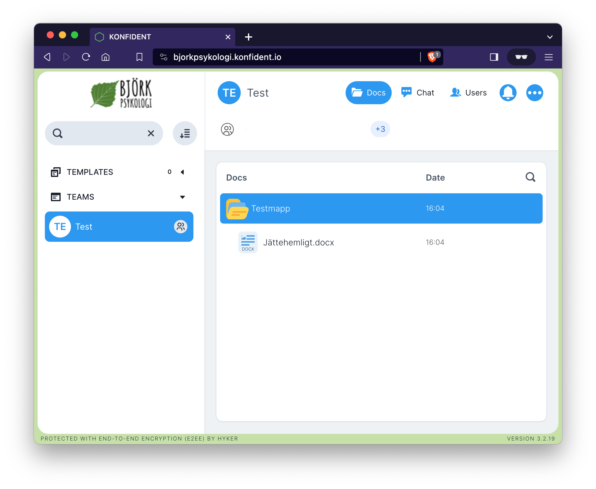

Konfident är en säker tjänst för att dela dokument som lever upp till patientdatalagens krav på säkerhet. Gör såhär för att använda tjänsten:

1. Vänta på en inbjudan i mejl från <bjorkpsykologi@konfident.io>.
2. **Följ inte länken i mejlet** utan gå till <https://bjorkpsykologi.konfident.io>.
3. Skriv in din mejladress och klicka på **Send Pin Code**.
   
4. Vänta på att du får ett mejl med en kod och skriv in den på hemsidan.
   
5. Klicka på **Login**.
   
6. Ange ditt personnummer och klicka på **Open Mobile BankID Dialog**.
   
7. Starta BankID-appen i din telefon och knappa in din kod.
8. Klart!
   

Nu kan du ladda upp dokument i de mappar jag förberett genom att dra och släppa eller högerklicka och välja **Upload File**.